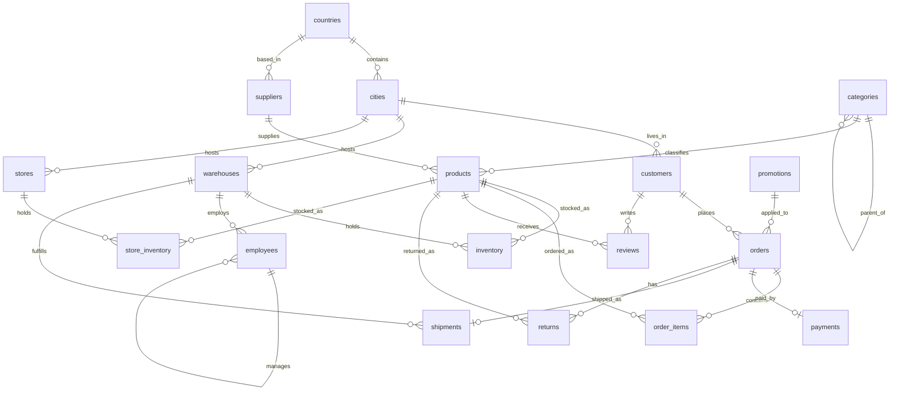

# SQL Practice Lab

A flexible, multi-database SQL curriculum and automated grading lab designed as a durable, metadata-driven learning environment. On this branch, the lab is tailored to **Microsoft SQL Server (T-SQL)**, powered by a pluggable `DatabaseAdapter` architecture that allows swapping underlying database engines (SQL Server, PostgreSQL, and future dialects) seamlessly.

## Quick start

1. Prerequisites:
   - Microsoft SQL Server (2019+ / 2022+ / 2025+) with **ODBC Driver 18 for SQL Server** installed.
   - Python 3.12+.
2. Create and activate a virtual environment, then install dependencies:
   ```powershell
   python -m venv .venv
   .venv\Scripts\Activate.ps1
   pip install -r requirements.txt
   ```
3. Initialize the database schema and deterministic seed data (defaults to local SQL Server with Windows Authentication):
   ```powershell
   python setup_database.py --recreate --scale dev
   ```
4. Render exercise prompts and registry:
   ```powershell
   python scripts/build_problems.py
   ```
5. Write your query in `exercises/01-select/q001.sql`, then grade it as described in [Grade answers](#grade-answers).

### Database connection & dialect configuration

By default, the lab connects to local Microsoft SQL Server using Windows Integrated Authentication:
`DRIVER={ODBC Driver 18 for SQL Server};SERVER=localhost;DATABASE=sql_practice;Trusted_Connection=yes;TrustServerCertificate=yes;`

Environment variables can customize connection behavior:
- `SQL_PRACTICE_DIALECT`: `sqlserver` (default) or `postgres`.
- `SQL_PRACTICE_DSN`: Custom ODBC connection string (SQL Server) or PostgreSQL connection URI.
- `SQL_PASSWORD` / `PGPASSWORD`: Database user password when using SQL authentication.

## Database setup modes

`python setup_database.py --recreate --scale dev` terminates active connections, drops and recreates `sql_practice`, loads `schema.sqlserver.sql`, generates dialect-compatible `data.sql`, and seeds all tables. Use it for a clean start.

`python setup_database.py --append --scale dev` preserves an existing initialized database and all of its rows. If the database does not exist, has no schema, or has a schema with no seed data, it initializes it.

Command-line flags supported by `setup_database.py`:
- `--dialect {sqlserver,postgres}`: Target engine dialect (default: `sqlserver`).
- `--database <name>`: Database name (default: `sql_practice`).
- `--scale {dev,full}`: Dataset scale (`dev` for rapid iteration, `full` for complete scale).
- `--dsn <conn_str>`: Custom connection string.
- `--password <pwd>`: Database password (if using SQL authentication).

You can also run manual seed generation if needed:
```powershell
python generate_data.py --dialect sqlserver --scale dev --output data.sql
```

## Database schema

The lab models a multi-warehouse retailer across 18 tables covering geography, customers, products, stock, staff, sales, and post-sale activity. In SQL Server, identity-backed columns use `BIGINT IDENTITY(1,1)` and timestamps use `DATETIME2`:



### Tables

| Table | Description | Key relationships |
| --- | --- | --- |
| `countries` | Country reference data identified by a unique two-letter code. | Referenced by `cities` and `suppliers`. |
| `cities` | Cities, unique within each country. | Belongs to `countries`; referenced by `customers`, `warehouses`, and `stores`. |
| `customers` | Customer profile, account status, email, and creation timestamp. | Optionally belongs to `cities`; places `orders` and writes `reviews`. |
| `suppliers` | Product suppliers and their contact details. | Optionally belongs to `countries`; supplies `products`. |
| `categories` | Product categories, including a self-referencing parent category for hierarchy exercises. | May have a parent `categories` row; classifies `products`. |
| `products` | Saleable products with SKU, price, active flag, supplier, and category. | Belongs to `suppliers` and `categories`; used in stock, order, review, and return tables. |
| `warehouses` | Warehouse locations, codes, names, and unit capacity. | Belongs to `cities`; holds `inventory`, employs `employees`, and fulfills `shipments`. |
| `inventory` | Warehouse-level stock and reorder thresholds. | Composite primary key: (`warehouse_id`, `product_id`); joins `warehouses` to `products`. |
| `employees` | Warehouse employees, roles, hire dates, and reporting hierarchy. | Optionally belongs to `warehouses`; `manager_id` self-references `employees`. |
| `promotions` | Discount codes with percentages and active date ranges. | May be applied to `orders`. |
| `orders` | Customer orders with status, order time, optional promotion, and shipping fee. | Belongs to `customers`; may use `promotions`; has items, a payment, and a shipment. |
| `order_items` | Products and quantities purchased in an order, preserving the unit price at purchase time. | Composite primary key: (`order_id`, `product_id`); joins `orders` to `products`. |
| `payments` | One payment record per order, with method, amount, time, and status. | One-to-one with `orders` through unique `order_id`. |
| `shipments` | One fulfillment shipment per order, including warehouse, tracking, dates, and status. | One-to-one with `orders`; fulfilled from `warehouses`. |
| `reviews` | Product ratings and optional review text from customers. | Belongs to `products` and `customers`; one review per customer/product pair. |
| `returns` | Requested returns of individual products from orders. | Belongs to `orders` and `products`; one return per order/product pair. |
| `stores` | Retail-store locations with codes, names, and opening dates. | Belongs to `cities`; holds `store_inventory`. |
| `store_inventory` | Store-level product stock. | Composite primary key: (`store_id`, `product_id`); joins `stores` to `products`. |

Important constraints support realistic practice queries: emails, codes, SKUs, and tracking numbers are unique; quantities and prices cannot be negative; and status fields are limited to documented lifecycle values. `order_items` cascade delete when orders are removed. Filtered and unique indexes support fast queries.

## Grade answers

The grader executes each answer and official solution inside an isolated transaction sandbox, then rolls back automatically so student queries and solutions never mutate the practice database. Results are compared across column names, row counts, duplicate multiplicity, ordering (when required), `NULL`s, and numeric values with floating-point tolerance.

Grade one exercise:
```powershell
python grader.py --problem Q001
```

Grade every exercise in a topic:
```powershell
python grader.py --topic "CONSTRAINTS"
python grader.py --topic "T-SQL FEATURES"
```

Grade all 175 exercises:
```powershell
python grader.py
```

Use `--problem` with an exercise ID such as `Q050`, or `--topic` with the topic name shown in the exercise heading. The command exits with code `0` only when every selected answer passes.

## Authoring exercises

Add structured metadata to `exercise_catalog.json`, create the matching solution in `solutions/`, and run `python scripts/build_problems.py`.

Each SQL file in `solutions/` and `exercises/` begins with two standardized comments:
```sql
-- Task (Q###): <exercise task statement>
-- Requirement: <exercise ordering requirement>
```

Existing answer files with student solutions are preserved.

## Verify data coverage

To verify that seed data makes all official solutions meaningful:
```powershell
python scripts/verify_data_coverage.py
```

See [architecture documentation](docs/architecture.md) for details on the multi-database abstraction layer and T-SQL support.
